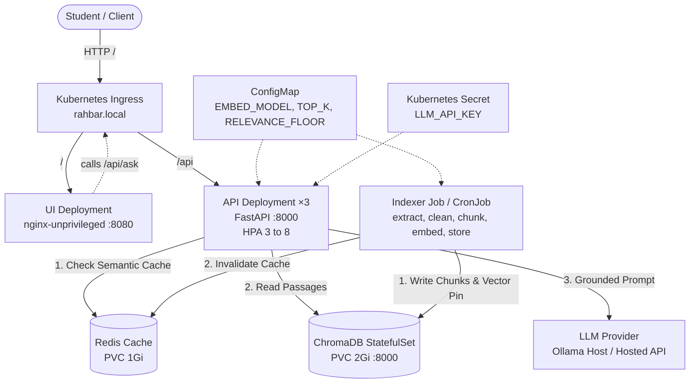

# RAHBAR: Grounded Academic RAG on Kubernetes

[](https://github.com)
[](https://kubernetes.io)
[](LICENSE)

RAHBAR is a fault-tolerant, grounded question-answering service deployed on Kubernetes over an authentic FAST-NUCES administrative corpus. Standard large language models operate with conversational fluency but lack verifiable factuality, hallucinating outdated or generic policies when asked about university regulations. RAHBAR bridges this gap by decoupling document indexing into a batch-oriented single-writer Kubernetes Job, enforcing temporal metadata filtering against superseded historical rules, validating citations against retrieved passages, and providing guaranteed schema-constrained answers with honest refusal on ungrounded topics.

---

## 1. System Architecture

RAHBAR enforces a strict separation of concerns: **the indexer Job is the sole writer to the vector database, and the replicated API pods operate purely in read-only mode.**



---

## 2. API Endpoints

The API is served on port 8000 and exposed via Ingress. All requests carry structured JSON logging and propagate `X-Request-ID`.

| Method | Endpoint | Probe / Function | Dependency Policy |
| :--- | :--- | :--- | :--- |
| GET | `/healthz` | Liveness Probe | **Touches no external dependencies.** Returns `{"status": "alive"}` to indicate process survival. |
| GET | `/readyz` | Readiness Probe | Checks Chroma reachability, non-empty collection (`count > 0`), Redis reachability, and compares `EMBED_MODEL` pin against collection metadata. Returns `HTTP 503` on conflict. |
| GET | `/metrics` | Prometheus Metrics | Exposes `rahbar_requests_total`, `rahbar_request_seconds`, retrieval/generation latency, cache hit ratios, abstention counts, and token estimates. |
| POST | `/api/ask` | Natural Language QA | Ingests `{"question": "..."}` (3 to 500 chars), verifies semantic cache, retrieves top-$k$, enforces relevance floor, prompts LLM, validates citations, and returns `AskResponse`. |

---

## 3. Quick Start: Clean Clone to Answered Question

### Step 1: Start Minikube with Calico CNI
Calico CNI is mandatory to enforce `NetworkPolicy` rules. The standard minikube network silently ignores policies.

```bash
minikube start --driver=docker --cni=calico --memory=6144 --cpus=4
minikube addons enable metrics-server
minikube addons enable ingress
```

### Step 2: Build Container Images and Load into Minikube
Build the multi-stage, non-root images locally and load them directly into minikube:

```bash
docker build -t rahbar-api:latest api/
docker build -t rahbar-indexer:latest indexer/
docker build -t rahbar-ui:latest ui/

minikube image load rahbar-api:latest
minikube image load rahbar-indexer:latest
minikube image load rahbar-ui:latest
```

### Step 3: Exact Kubernetes Apply Order

```bash
# 1. Create the dedicated namespace
kubectl apply -f k8s/base/namespace.yaml

# 2. Create the Secret from the command line (NEVER committed to git)
kubectl create secret generic rahbar-secret -n rahbar \
  --from-literal=LLM_API_KEY="${LLM_API_KEY:-placeholder_key}" \
  --dry-run=client -o yaml | kubectl apply -f -

# 3. Apply base configuration and service accounts
kubectl apply -f k8s/base/configmap.yaml
kubectl apply -f k8s/base/serviceaccounts.yaml

# 4. Deploy stateful data tiers (Chroma & Redis)
kubectl apply -f k8s/base/chroma-statefulset.yaml
kubectl apply -f k8s/base/redis.yaml

# 5. Deploy application serving tiers (API, UI, Ingress, HPA, NetworkPolicy)
kubectl apply -k k8s/overlays/prod

# 6. Wait for data tier rollout
kubectl rollout status statefulset/chroma -n rahbar --timeout=120s
kubectl rollout status deployment/redis -n rahbar --timeout=120s
```

---

## 4. Running the Indexer Job

Because the API only reads from Chroma, all API pods will report `0/1 READY` until the indexer runs and creates the collection. Run the indexer Job:

```bash
# Execute the indexer job manually from the CronJob template:
kubectl create job --from=cronjob/reindex manual-index-1 -n rahbar

# Watch the indexer complete:
kubectl get jobs -n rahbar -w
kubectl logs job/manual-index-1 -n rahbar
```

Once the Job completes with exit code 0, all 3 API pods pass their `/readyz` probes and transition to `1/1 READY`:

```bash
kubectl rollout status deployment/api -n rahbar
kubectl get pods -n rahbar
```

---

## 5. Querying the Service

Add `rahbar.local` to your `/etc/hosts` (pointing to `minikube ip` or `127.0.0.1` if running `minikube tunnel`).

```bash
# Ordinary grounded query:
curl -s -X POST "http://rahbar.local/api/ask" \
  -H "Content-Type: application/json" \
  -d '{"question": "What is the minimum attendance requirement for final examinations?"}' | jq .

# Must-abstain query (Hostel rules deliberately omitted):
curl -s -X POST "http://rahbar.local/api/ask" \
  -H "Content-Type: application/json" \
  -d '{"question": "What is the curfew time for student hostels at FAST-NUCES?"}' | jq .
```
